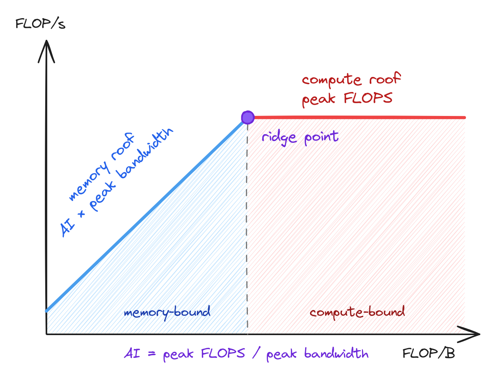

# GEMMs
Matrix size will be $M \times N \times K = 4096 \times 4096 \times 4096$

## Benchmark summary

#### On NVIDIA Tesla V100
- Model: Tesla V100-SXM2-32GB
- FP32 peak FLOPS: about $15.7$ TFLOP/s 
    - 80 SMs $\times$ 64 FP32 cores $\times$ 2 FLOP $\times$ 1.53 GHz
- Peak bandwidth: 898 GB/s
- Benchmark setup: Median of 100 runs after 10 warmup runs

#### Benchmark table

| Kernel | Time (ms) | FLOPS (GFLOP/s) | FLOPS util. (% of peak) | Speedup vs naive | Speedup vs previous | Effective BW (GB/s) | BW util. (% of peak) |
|---|---:|---:|---:|---:|---:|---:|---:|
| Naive | 581.27 | 236.4 | 1.5 | 1.0× | – | 0.35 | 0.04 |
| Global memory coalescing | 73.23 | 1876.9 | 12.0 | 7.9× | 7.9× | 2.75 | 0.31 |
| Shared memory caching | 34.87 | 3942.0 | 25.1 | 16.7× | 2.1× | 5.77 | 0.64 |
| 1D tiling | 17.32 | 7936.7 | 50.6 | 33.6× | 2.0× | 11.63 | 1.29 |
| 2D tiling | 15.60 | 8810.4 | 56.2 | 37.3× | 1.1× | 12.91 | 1.44 |
| 2D tiling + vectorized loads | 11.29 | 12176.2 | 77.6 | 51.5× | 1.4× | 17.84 | 1.99 |

#### Interpreting the data

Before analyzing the actual numbers, let's calculate some relevant metrics:
- Rate of computation: $\frac{2 \cdot M \cdot N \cdot K}{\text{time executed (s)}}\cdot 10^{-9}$ (GFLOP/s)
- Minimum effective bandwidth: $\frac{(M \cdot K + K \cdot N + M \cdot N) \cdot (\text{sizeof(data) (bytes)})}{\text{time executed (s)}} \cdot 10^{-9}$ (GB/s)

Note that since GEMMs are relatively compute-intensive operation, we shall put more emphasis on the FLOPS analysis rather than the bandwidth analysis. Ultimately, the goal is to attain as close as possible to the peak FLOPS for that data type.

#### Roofline model
The roofline model can be a useful way to analyze the performance of a kernel. This introduce a new metric: 

- Arithmetic intensity = $\frac{\text{Computational rate}}{\text{Effective bandwidth}} \le \frac{2MNK}{(MK + KN + MN) \cdot \text{ sizeof(data)}}$ (FLOP/Byte)

A graphical view of the model is:

See also: https://en.wikipedia.org/wiki/Roofline_model

##### Arithmetic intensity

Our goal is to increase AI as much as possible to push the kernel into the compute-bound region. Profilers (e.g. Nsight Compute, which I currently don't have access to) can be helpful in analyzing AI in practice. 

However we can do a rough estimate/lower-bound based on how each kernel executes. For now, let's consider only global-memory loads and ignoring L1/L2 cache hits.

- Global-memory-only kernels: since each FMA (2 FLOP) loads one float of $A$ and one of $B$, we have AI $= 2/8 = 0.25$ FLOP/B
- Shared-memory kernels needs a little more work:

    Let tile sizes of $A$ and $B$ be $BM \times BK$ and $BK \times BN$ respectively. Then, a thread-block loads $(BM + BN) \cdot BK$ floats, then does $2 \cdot BM \cdot BN \cdot BK$ FLOPs. Hence, for each tile

    $\text{AI} = \frac{BM \cdot BN \cdot BK}{2(BM + BN) \cdot BK} = \frac{BM \cdot BN}{2(BM + BN)}$ FLOP/B

    This ratio retain as we slide the tile $K / BK$ steps. 

    For $A, B$ tile sizes of $64 \times 8$ and $8 \times 64$ respectively, for example, AI would be approximately $16$ FLOP/B.

Ideally, if every element read from DRAM once, we have $\text{AI} = \frac{2MNK}{(MK + KN + MN) \cdot \text{sizeof(data)}}$. This is equals to $N/6$ for FP32, $M=N=K$, hence scales with $N$. For $M=N=K=4096$, this ideal limit is approximately 683 FLOP/B. But this will hardly be feasible since we have limited on-chip memory.

Note that even though these are theoretically valid calculations, in practice we need to also consider shared memory capabilities and/or register pressure. More on this as I explore :)

##### Ridge point analysis

Again our goal is to push the kernel over the ridge point. For kernels still in memory-bound area, we have: 

$$
\text{Memory-roof FLOPS} = \text{AI} \times \text{bandwidth}
$$

Using the estimate AI calculations above, again we look at the achieved FLOPS of each kernel:

| Kernel | Measured FLOPS (GFLOP/s) | Memory-roof FLOPS (GFLOP/s) | Est. AI (FLOP/B) | Interpretation |
|---|---:|---:|---:|---|
| Naive | 236.4 | 224.5 | 0.25 | At the roof, but by coincidence: uncoalesced loads waste bandwidth |
| Global memory coalescing | 1876.9 | 224.5 | 0.25 | 8× above the roof, which means actual AI is higher (since we exclude L1/L2 in our theoretical AI) |
| Shared memory caching | 3942.0 | 7184 | 8 | Below the roof, but this is not DRAM-bound (limited by on-chip work) |
| 1D tiling | 7936.7 | 14368 | 16 | Near the ridge point, still well below the roof |
| 2D tiling | 8810.4 | 14368 | 16 | Similar AI as 1D, slightly better |
| 2D tiling + vectorized loads | 12176.2 | 14368 | 16 | Same AI, but now we're at 85% of the roof (due to fewer load instructions per FMA) |

<!-- Memory-roof $= \text{Est. AI} \times 898$ GB/s. The ridge point is $15.7\text{ TFLOP/s} / 898\text{ GB/s} \approx 17.5$ FLOP/B, so every kernel here is still (just) left of it. -->

Finding ways to attain better FLOPS, henceby, are the goals of subsequent optimizations. More on this later :)

---

## Kernel analysis
#### Naive kernel
In this variant, each thread compute one entry ($1 \times 1$) of $C$, with `x` dimensions representing rows and `y` representing cols. 
#### Global memory coalescing kernel
In this variant, each thread compute one entry ($1 \times 1$) of $C$. By swapping the role of `x` and `y`, neighboring threads are able to access contiguous data of $A$ and $C$, while sharing a column of $B$ (via broadcasting).
#### Shared memory caching kernel
In this variant, each thread compute one entry ($1 \times 1$) of $C$, while loading a $32 \times 32$ tile of $A$ and $B$ into shared memory.

#### 1D tiling kernel
In this variant, each thread compute a $8 \times 1$ block of $C$. Tile size is specified to be 64x8. 

#### 2D tiling kernel
In this variant, each thread compute a $8 \times 8$ block of $C$. Tile size is specified to be $64 \times 8$, so essentially a block covers a $64 \times 64$ block in $C$.
#### Vectorized load on 2D tiling kernel
The kernel is similar to the previous 2D tiling kernel, but with faster data access (dealing with a vector of $4$ floats at once).
